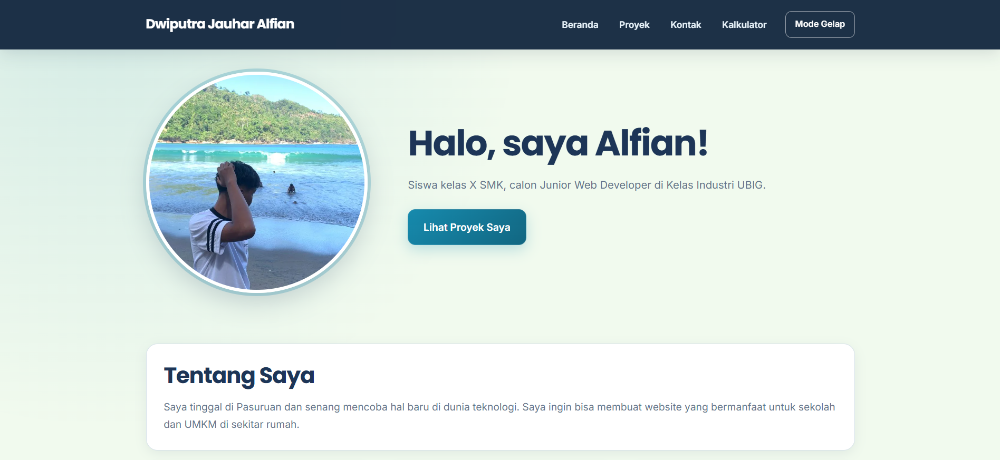

Portofolio Dwiputra Jauhar Alfian

Website portofolio pribadi yang saya buat di Kelas Industri UBIG (Paket 1, Minggu 01 sampai 09).

Website ini merupakan Portofolio v2 yang dirancang agar tampil rapi di ponsel, tablet, dan laptop, serta dilengkapi berbagai fitur interaktif menggunakan JavaScript.

## Tampilan

##Fitur

* Halaman Beranda berisi profil pribadi, hobi, cita-cita, keahlian dari data/keahlian.json, dan jadwal belajar mandiri.
* Halaman Proyek menampilkan enam kartu proyek dari data/proyek.json dengan filter kategori HTML, CSS, dan JavaScript.
* Menampilkan daftar repositori GitHub terbaru menggunakan GitHub REST API.
* Halaman Kontak menyediakan formulir dengan validasi dan penghitung karakter pesan maksimal 300 karakter.
* Halaman Kalkulator untuk menghitung rata-rata nilai tugas, UTS, dan UAS.
* Fitur Mode Gelap untuk mengubah tampilan website.
* Menu navigasi responsif untuk ponsel dan laptop.
* Tampilan responsif menggunakan Flexbox dan media query.
* Optimasi gambar menggunakan format WebP untuk membantu meningkatkan performa website.

##Teknologi

* HTML5 untuk struktur halaman website.
* CSS3 (Flexbox, media query, dan variabel CSS) untuk desain dan responsivitas.
* JavaScript (DOM, event, fetch, dan async/await) untuk fitur interaktif.
* JSON untuk menyimpan data proyek dan keahlian.
* Git dan GitHub untuk pengelolaan versi kode.
* Vercel untuk deployment website.
* Google Fonts untuk tipografi.

##Skor Lighthouse

Hasil pengujian Lighthouse pada halaman Proyek:

* Performance: 92
* Accessibility: 95
* Best Practices: 96
* SEO: 100

Catatan: Skor dapat berubah tergantung perangkat, kondisi jaringan, dan hasil pengujian.

##Tautan
* Website: https://portofolio-alfian2.vercel.app

Dibuat oleh: Dwiputra Jauhar Alfian
Kelas: X RPL 1
Sekolah: SMKN 1 Kota Pasuruan
Program: Kelas Industri UBIG